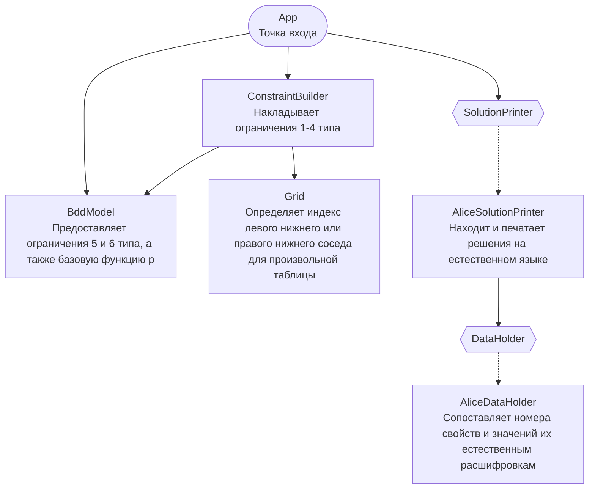

# Комментарии к работе

## Мой вариант

- A = 14
- B = 40105
- C = 9

Дополнительные значения варианта:
- a = 40119
- b = 23
- v1 = 24 (* слева-снизу, справа-снизу)
- v2 = 2 (склейка по верхним/нижним границам)
- v3 = 3 (n1 = 7, n2 = 5, n3 = 5, n4 = 4)
- N = 9 (9 объектов и 9 значений свойств)
- M = 4 (4 свойства)
- T = 4 (4 бита на алфавит свойств)
- Итого: N \* M \* T = 144 бинарных переменных

Далее будем нумеровать:
- i (object) — номер места за столом (объект) (0:N-1)
- k (prop) — номер свойства (0:M-1)
- j (value) — номер конкретного значения свойства (0:N-1)
- t (bit) — позиция бита в двоичной записи числа j (0:T-1)

### Свойства

| | k = 0: Гость | k = 1: Чай | k = 2: Угощение | k = 3: Чашка |
| --- | --- | --- | --- | --- |
| j = 0 | Алиса | Дарджилинг | Хлеб с маслом | Фарфоровая |
| j = 1 | Безумный шляпник | Ассам | Апельсиновый мармелад | Треснувшая |
| j = 2 | Мартовский заяц | Эрл Грей | Кексы со смородиной | Без ручки |
| j = 3 | Соня | Мятный | Пудинг | Без дна |
| j = 4 | Белый кролик | Каркаде | Имбирное печенье | Стеклянная |
| j = 5 | Чеширский кот | Улун | Булочка с повидлом | Съедобная |
| j = 6 | Герцогиня | Анчан | Булочка с корицей | Золотая |
| j = 7 | Шалтай-Болтай | Зеленый | Рахат-лукум | Железная |
| j = 8 | Гусеница | Ромашковый | Кексы с цукатами | Крошечная |

### Нумерация

| 0 | 1 | 2 |
| --- | --- | --- |
| 3 | 4 | 5 |
| 6 | 7 | 8 |

r = i // 3\
c = i mod 3

Соседские отношения:
- Соседями центрального элемента являются объекты справа-снизу и слева-снизу (тип 4).
- Отношение "слева" будем понимать как объект слева-снизу, а "справа" — справа-снизу (тип 3).

| Соседи без склейки | Слева-снизу | Справа-снизу |
| --- | --- | --- |
| 0: | --- | 4 = (1, 1) |
| 1: | 3 = (1, 0) | 5 = (1, 2) |
| 2: | 4 = (1, 1) | --- |
| 3: | --- | 7 = (2, 1) |
| 4: | 6 = (2, 0) | 8 = (2, 2) |
| 5: | 7 = (2, 1) | --- |
| 6: | --- | --- |
| 7: | --- | --- |
| 8: | --- | --- |

|Соседи со склейкой | Слева-снизу | Справа-снизу |
| --- | --- | --- |
| 0: | --- | 4 = (1, 1) |
| 1: | 3 = (1, 0) | 5 = (1, 2) |
| 2: | 4 = (1, 1) | --- |
| 3: | --- | 7 = (2, 1) |
| 4: | 6 = (2, 0) | 8 = (2, 2) |
| 5: | 7 = (2, 1) | --- |
| 6: | --- | 1 = (0, 1) |
| 7: | 0 = (0, 0) | 2 = (0, 2) |
| 8: | 1 = (0, 1) | --- |

## Пример рассадки

| | | |
| --- | --- | --- |
| 0: [Алиса, Ассам, Кексы со смородиной, Без дна] [0,1,2,3] | 1: [Безумный шляпник, Эрл-Грей, Пудинг, Стеклянная] [1, 2, 3, 4] | 2: [Мартовский заяц, Мятный, Имбирное печенье, Съедобная] [2, 3, 4, 5] |
| 3: [Соня, Каркаде, Булочка с повидлом, Золотая] [3, 4, 5, 6] | 4: [Белый кролик, Улун, Булочка с корицей, Железная] [4, 5, 6, 7] | 5: [Чеширский кот, Анчан, Рахат-лукум, Крошечная] [5, 6, 7, 8] |
| 6: [Герцогиня, Зеленый, Кексы с цукатами, Фарфоровая] [6, 7, 8, 0] | 7: [Шалтай-Болтай, Ромашковый, Хлеб с маслом, Треснувшая] [7, 8, 0, 1] | 8: [Гусеница, Дарджилинг, Апельсиновый мармелад, Без ручки] [8, 0, 1, 2] |

## Мои ограничения

### Тип 1

| № | Естественная формулировка | В переменных |
| - | - | - |
| 1 | На центральном столике стоит железная чашка. | (prop = 3, object = 4, value = 7) |
| 2 | Чеширский кот расположился справа. | (prop = 0, object = 5, value = 5) |
| 3 | За третьим местом пьют каркаде. | (prop = 1, object = 3, value = 4) |
| 4 | Шалтай-Болтай сидит снизу. | (prop = 0, object = 7, value = 7) |
| 5 | Справа сверху пьют чай из съедобной кружки. | (prop = 3, object = 2, value = 5) |
| 6 | Слева снизу едят кексы с цукатами. | (prop = 2, object = 6, value = 8) |
| 7 | Сверху сидит Безумный шляпник. | (prop = 0, object = 1, value = 1) |

### Тип 2 

| № | Естественная формулировка | В переменных |
| - | - | - |
| 1 | Гусеница ест апельсиновый мармелад. | (prop1 = 0, value1 = 8, prop2 = 2, value2 = 1) |
| 2 | Зеленый чай пьют из фарфоровой кружки. | (prop1 = 1, value1 = 7, prop2 = 3, value2 = 0) |
| 3 | Имбирное печенье едят с мятным чаем. | (prop1 = 2, value1 = 4, prop2 = 1, value2 = 3) |
| 4 | Чеширский кот пьет из крошечной чашки. | (prop1 = 0, value1 = 5, prop2 = 3, value2 = 8) |
| 5 | Соня ест булочку с повидлом. | (prop1 = 0, value1 = 3, prop2 = 2, value2 = 5) |

### Тип 3

| № | Естественная формулировка | В переменных |
| - | - | - |
| 1 | Соня слева снизу от стола с пудингом. | (prop1 = 0, value1 = 3, prop2 = 2, value2 = 3, right = false) |
| 2 | Булочка с корицей справа снизу от кексов со смородиной. | (prop1 = 2, value1 = 6, prop2 = 2, value2 = 2, right = true) |
| 3 | Гусеница справа снизу от Белого кролика. | (prop1 = 0, value1 = 8, prop2 = 0, value2 = 4, right = true) |
| 4 | Каркаде стоит на столе слева снизу от стеклянной чашки. | (prop1 = 1, value1 = 4, prop2 = 3, value2 = 4, right = false) |
| 5 | Шалтай-Болтай слева снизу от стола с рахат-лукумом. | (prop1 = 0, value1 = 7, prop2 = 2, value2 = 7, right = false) |

### Тип 4

| № | Естественная формулировка | В переменных |
| - | - | - |
| 1 | Улун стоит на столике рядом снизу от мятного чая. | (prop1 = 1, value1 = 5, prop2 = 1, value2 = 3) |
| 2 | Крошечная чашка рядом снизу от Эрл-Грея. | (prop1 = 3, value1 = 8, prop2 = 1, value2 = 2) |
| 3 | Треснувшая чашка рядом снизу от золотой. | (prop1 = 3, value1 = 1, prop2 = 3, value2 = 6) |
| 4 | Герцогиня рядом снизу от Белого кролика. | (prop1 = 0, value1 = 6, prop2 = 0, value2 = 4) |

### Дополнительные ограничения

#### Без склейки

| № | Тип | Естественная формулировка | В переменных |
| - | - | - | - |
| 1 | 1 | Слева сверху пьют чай из кружки без дна | (prop = 3, object = 0, value = 3) |
| 2 | 1 | На 8 месте пьют дарджилинг | (prop = 1, object = 8, value = 0) |

#### Со склейкой

| № | Тип | Естественная формулировка | В переменных |
| - | - | - | - |
| 1 | 1 | На 8 месте пьют дарджилинг | (prop = 1, object = 8, value = 0) |
| 2 | 3 | Мартовский заяц сидит справа снизу от столика с ромашковым чаем | (prop1 = 0, value1 = 2, prop2 = 1, value = 8, right = true) |
| 3 | 4 | Анчан пьют рядом снизу от столика, за которым едят пудинг | (prop1 = 1, value1 = 6, prop2 = 2, value2 = 3) |

## Архитектура классов

